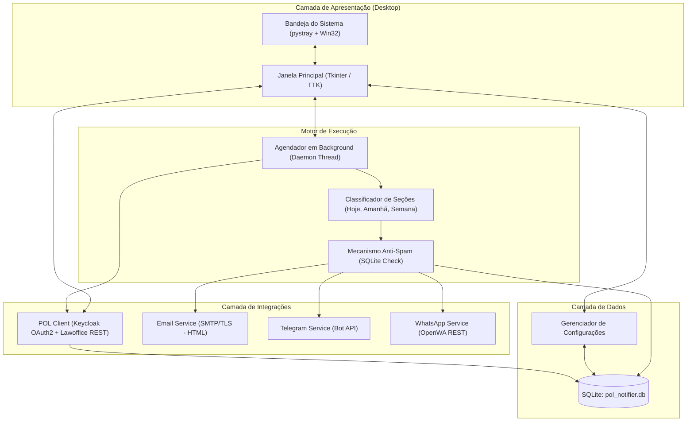

# Technical Plan — POL ADV Notifier Desktop

## 1. Arquitetura de Componentes

---

## 2. Esquema do Banco de Dados SQLite (`pol_notifier.db`)

### Tabela `settings`
Armazena pares chave-valor das preferências e credenciais:
* `key` (TEXT PRIMARY KEY)
* `value` (TEXT)
* `updated_at` (TIMESTAMP)

Chaves previstas:
- `pol_email`, `pol_password`, `pol_office_id`, `pol_user_id`
- `check_interval_minutes` (padrão: 60)
- `notify_time_daily` (ex: "08:00")
- `smtp_host`, `smtp_port`, `smtp_user`, `smtp_pass`, `smtp_from`, `smtp_recipients`, `smtp_ssl_tls`, `email_enabled`
- `telegram_token`, `telegram_chat_ids`, `telegram_enabled`
- `openwa_url`, `openwa_api_key`, `openwa_recipients`, `openwa_enabled`

### Tabela `cached_items`
Armazena a cópia local das tarefas e eventos para exibição offline e cálculo de deltas:
* `id` (TEXT PRIMARY KEY - ex: `task_1234` ou `event_5678`)
* `type` (TEXT - `TASK` ou `EVENT`)
* `title` (TEXT)
* `description` (TEXT)
* `status` (TEXT)
* `priority` (TEXT)
* `deadline` (TIMESTAMP)
* `raw_json` (TEXT)
* `updated_at` (TIMESTAMP)

### Tabela `notification_history`
Previne duplicidade de notificações por dia civil:
* `id` (INTEGER PRIMARY KEY AUTOINCREMENT)
* `item_id` (TEXT)
* `channel` (TEXT - `EMAIL`, `TELEGRAM`, `OPENWA`)
* `section` (TEXT - `TODAY`, `TOMORROW`, `WEEK`, `OVERDUE`)
* `recipient` (TEXT)
* `sent_at` (TIMESTAMP)
* `status` (TEXT - `SUCCESS` ou `ERROR`)
* `error_message` (TEXT)

### Tabela `app_logs`
Logs operacionais para exibição na aba de auditoria:
* `id` (INTEGER PRIMARY KEY AUTOINCREMENT)
* `level` (TEXT - `INFO`, `WARNING`, `ERROR`)
* `message` (TEXT)
* `timestamp` (TIMESTAMP)

---

## 3. Fluxo de Autenticação e Renovação POL ADV
1. `POLClient.authenticate()` envia requisição `POST` com `grant_type=password`, `client_id=web_app`, `username` e `password` para `https://keycloak.pol.adv.br/auth/realms/pol-prod/protocol/openid-connect/token`.
2. Em caso de sucesso, armazena `access_token`, `refresh_token` e calcula `token_expiry`.
3. Executa `GET /api/account` para confirmar a identidade e capturar o UUID do usuário.
4. Executa `GET /services/lawoffice/api/user/preferences` para obter ou validar o `idOffice` (Tenant).
5. Se o token estiver a menos de 5 minutos de expirar, aciona renovação automática via `grant_type=refresh_token`.

---

## 4. Pipeline de Notificação e Formatação
1. **Extração:** Coleta tarefas com `isArchived == false` e eventos com data final `>= hoje`.
2. **Classificação:**
   - **Hoje:** `data == hoje`
   - **Amanhã / Próximos 2 dias:** `hoje < data <= hoje + 2 dias`
   - **Esta Semana:** `hoje + 2 dias < data <= hoje + 7 dias`
   - **Atrasados:** `data < hoje` e status não finalizado.
3. **Deduplicação:** Verifica se o item já foi despachado para aquele canal na mesma data civil (`sent_at::date == hoje`).
4. **Despacho Paralelo ou Sequencial Seguro:**
   - Se houver novos itens elegíveis, monta as mensagens consolidadas por seção e despacha para cada canal habilitado.
