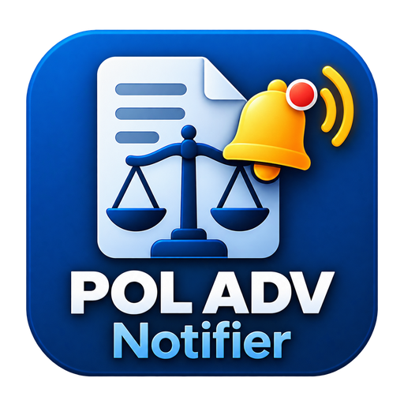

<p align="center"></p>

# POL ADV Notifier

Monitora os **prazos e audiências** da plataforma jurídica **POL ADV** ([office.pol.adv.br](https://office.pol.adv.br)) e avisa por **e-mail, Telegram e WhatsApp**. Funciona como aplicativo de Windows (com widget na Área de Trabalho) e como site no Cloudflare.

| Edição | O que é | Onde |
|---|---|---|
| **Desktop** (.NET 10 + WPF) | Painel, widget na Área de Trabalho, bandeja do sistema e agendador | [Instalador da última versão](https://github.com/sergiobaiao/pol_monitor/releases/latest/download/PolNotifier-Setup.exe) |
| **Web** (Python Worker no Cloudflare) | O mesmo painel no navegador, com monitor 24 h no servidor | https://pol-adv-web.victorlimapge.workers.dev |
| **Swagger/proxy** | Explorador das rotas da API do POL, com proxy CORS | `python server.py` |

O desktop em Python (`app/`) é a versão antiga, mantida só como referência.

---

## O que faz

**Painel** com seis abas, no desktop e na web:
- **Início:** contadores (hoje, próximos 2 dias, semana, atrasadas) e os prazos e compromissos mais próximos.
- **Tarefas:** *Lista* (padrão, com busca e filtros) e *Kanban* como no POL (A fazer, Em andamento, A revisar, Concluídas).
- **Calendário:** *Mês* como no POL (cores: pendente azul, atrasada vinho, concluída verde) e *Lista* com tudo do mês, por dia. Clicar numa entrada abre os detalhes completos.
- **Notificações, Configurações e Logs.**

**Widget na Área de Trabalho** (desktop): estilo Stardock Fences, translúcido, arrastável, redimensionável e recolhível, com os 4 contadores e a lista de prazos. Fica atrás dos outros apps e continua visível no **Win + D**. Posição, tamanho e opacidade são salvos por usuário.

**Relatório diário e alerta urgente**, nos canais que estiverem **Ativos**:
- **E-mail:** título "Publicações Online - Relatório de Tarefas Diário para dd/MM/aaaa" (com **URGENTE:** no assunto quando algum prazo vence hoje). A seção **Hoje** vem sempre primeiro; depois próximos 2 dias, semana e atrasados.
- **Telegram e WhatsApp:** o mesmo resumo em texto, com um marcador de urgência por item: 🔴 atrasado ou hoje, 🟠 até 2 dias, 🟡 até 5, 🟢 mais adiante, ⚪ sem prazo.
- **Cores por urgência:** títulos e datas vão do vermelho (hoje) ao verde (7 dias ou mais), no e-mail, no widget e no painel.
- **Sem repetição:** cada canal recebe o resumo uma vez por dia, a menos que apareça um item novo. O botão **📨 Relatório** (desktop) e **Enviar relatório agora** (web) reenviam na hora.
- O desktop e a web geram mensagens **idênticas**.

**Conta da API:** o login identifica quem usa o app, mas os dados do POL podem vir de **outra conta**. Em *Configurações → Conta POL ADV* informe o usuário e a senha da API (por padrão é a conta do login). Ao trocar, o app valida as credenciais, limpa os dados em cache e passa a usar o escritório dessa conta; "Usar a conta do login" desfaz.

**Vários usuários:** cada usuário tem as próprias configurações. A senha lembrada fica no Gerenciador de Credenciais do Windows (desktop) e só o refresh token de quem marca "Lembrar" fica no servidor (web).

---

## Instalar o desktop

1. Baixe o [instalador](https://github.com/sergiobaiao/pol_monitor/releases/latest/download/PolNotifier-Setup.exe). Ele é por usuário e **não pede administrador**.
2. Marque o que quiser: atalho na Área de Trabalho, pasta no Menu Iniciar e **iniciar junto com o Windows** (também dá para mudar depois em *Configurações → Inicialização*).
3. Abra o app, entre com seu e-mail e senha do POL ADV e marque "Lembrar" se quiser entrar sozinho nas próximas vezes.

Também há o `PolNotifier.exe` avulso (não precisa do .NET instalado) na [página de releases](https://github.com/sergiobaiao/pol_monitor/releases).

Ao fechar ou minimizar, o app vai para a **bandeja do sistema** (menu: abrir painel, sincronizar, enviar último relatório, mostrar/ocultar widget, trocar usuário, encerrar). Só uma instância roda por vez.

Os dados do usuário ficam em `%LOCALAPPDATA%\POL ADV Notifier\data`. Para usar outra pasta, defina `POL_DATA_DIR`.

---

## Configurar os canais

Em **Notificações**, ligue o interruptor **Ativo** do canal, preencha os campos, salve e use **Testar** (o teste usa o que está digitado; o de e-mail envia o relatório real).

- **E-mail (desktop):** SMTP. Para Gmail, use `smtp.gmail.com`, porta `587` (ou `465` com "SSL direto") e uma **senha de app** do Google (exige a verificação em duas etapas): https://myaccount.google.com/apppasswords. Vários destinatários, separados por vírgula ou `;`.
- **E-mail (web):** escolha entre **senha de app do Google** (SMTP, como acima) e **OAuth do Google** (Gmail API, com um cliente OAuth criado no seu Google Cloud; o passo a passo está na própria tela).
- **Telegram:** crie um bot no @BotFather, informe o token e os Chat IDs. Cada pessoa precisa abrir o bot e enviar `/start`, senão o Telegram responde "chat not found".
- **WhatsApp:** servidor OpenWA/WPPConnect seu (URL, API key opcional e números com DDI, ex.: `5511999999999`).

---

## Web

- **Login:** o mesmo e-mail e senha do POL. Com "Lembrar", o monitor 24 h continua rodando no servidor mesmo com o navegador fechado (cron a cada 5 minutos; cada usuário respeita o próprio intervalo).
- **Armazenamento:** usuários, sessões e configurações ficam no KV `POL_STORE` da Cloudflare.
- **E-mail com TLS:** o envio SMTP passa por um Worker auxiliar em JavaScript (`smtp-worker/`), porque o Python do Worker ainda não faz TLS em sockets.

---

## Desenvolvimento

**Requisitos:** .NET SDK 10, Python 3.14, Node 22 (para o Wrangler e para `smtp-worker/test.mjs`). Windows para o desktop.

```powershell
.\desktop-wpf\build.ps1                          # compila (0 warnings esperados)
dotnet run --project desktop-wpf\PolNotifier      # roda o desktop
.\desktop-wpf\publish.ps1 -Version 2.1.3         # .exe único + instalador NSIS (precisa do makensis)
python app-web.py                                 # web local
node smtp-worker/test.mjs                         # testa o cliente SMTP do Worker auxiliar
python -c "import py_compile; py_compile.compile('app-web.py', doraise=True)"
python server.py                                  # Swagger UI + proxy CORS (http://127.0.0.1:8000)
```

Não há suíte de testes automatizada: a verificação é o build sem warnings, o `py_compile`, o teste do SMTP e conferir o app rodando.

```
desktop-wpf/        Desktop .NET (Core/ lógica, Ui/ telas, installer/ NSIS, build.ps1, publish.ps1)
app-web.py          Web: servidor local e Python Worker (SPA embutida)
smtp-worker/        Worker JavaScript auxiliar para SMTP com TLS
wrangler.toml       Deploy do Worker (cron, KV, service binding)
release.ps1         Cria e envia a próxima tag vX.Y.Z
assets/             Logo do app
server.py, index.html, download_specs.py   Explorador da API do POL
app/                Desktop antigo em Python (referência)
.github/workflows/  CI/CD
.spec-kit/          Requisitos e decisões (Spec-Driven Development)
```

**Desktop e web têm lógicas separadas** (classificação de prazos, e-mail, Telegram, cores). Ao mudar uma, replique na outra e compare as saídas.

### Lançar uma versão

```powershell
.\release.ps1                  # patch: 2.1.2 -> 2.1.3  (-Bump minor|major; -DryRun só mostra)
```

O script cria a tag `vX.Y.Z` e a envia. O GitHub Actions compila o desktop, gera o instalador e publica a **release** (marcada como *latest*); a web é publicada no Worker a cada push em `main` que mexa nela.

### CI/CD (`.github/workflows/`)

- **`desktop.yml`:** compila e gera o instalador a cada mudança em `desktop-wpf/`; em tag `v*`, publica a release com `PolNotifier-Setup-X.Y.Z.exe`, `PolNotifier-Setup.exe` e `PolNotifier.exe`.
- **`web.yml`:** testa o `smtp-worker`, publica o Worker auxiliar e depois o principal. Precisa dos segredos `CLOUDFLARE_API_TOKEN` e `CLOUDFLARE_ACCOUNT_ID` no repositório.

---

## Segurança e privacidade

O repositório é público. **Nunca** vão para ele: `.env`, a pasta `data/` (bancos com configurações e histórico), tokens, senhas e o JWT do POL. A senha do POL nunca é gravada em arquivo: fica só no Gerenciador de Credenciais do Windows (se você marcar "Lembrar") e em memória. O arquivo `swagger/*.json` é gerado com o seu login e também não é versionado (`POL_TOKEN` no ambiente para gerá-lo com `download_specs.py`).

---

## Documentação do projeto

- [`desktop-wpf/README.md`](desktop-wpf/README.md): detalhes do desktop (instalador, dados, widget, estrutura).
- [`AGENTS.md`](AGENTS.md): APIs do POL, arquitetura, estrutura de arquivos e histórico de armadilhas.
- [`CLAUDE.md`](CLAUDE.md) e [`GEMINI.md`](GEMINI.md): guias de trabalho para assistentes de IA (mantidos iguais ao `AGENTS.md`).
- [`.spec-kit/`](.spec-kit/): requisitos, plano e tarefas.
